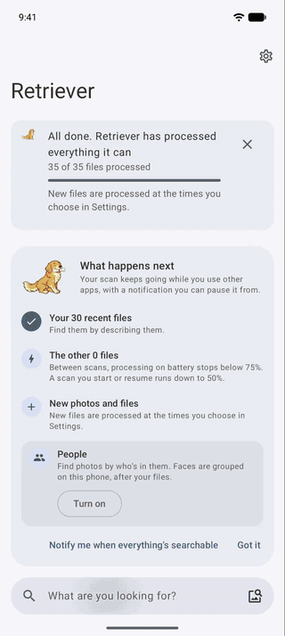

# Retriever

Search your phone's photos, documents and videos by describing them, entirely on the device.
Google's EmbeddingGemma 2 runs locally through LiteRT-LM (on the NPU on Pixel Tensor G5/G6), behind a
Kotlin Multiplatform core with native Android (Compose Material 3) and iOS (SwiftUI) apps.

[Google Play](https://play.google.com/store/apps/details?id=app.retriever) ·
[App Store](https://apps.apple.com/app/id6829902478) · free, no ads, no account · Apache-2.0



The demo runs on a sample library, not a real one.

- Name, document-text, OCR and photo-label search work without the large search model.
- A downloadable EmbeddingGemma 2 model adds search by description and visual similarity.
- Browse folders, star files, find duplicate copies, and open matched pages or video moments.
  People recognition is opt-in. Audio files are currently found by name.

## Privacy

File processing, queries and the search index stay on the device. Search-model downloads need internet;
Android may also download OCR models through Google Play services, and cloud file providers may fetch
selected files. Search models are pinned to a commit and verified with SHA-256 before use.
There is no Retriever account or backend.

## Structure

```text
core/        Shared search, indexing, storage and platform adapters; builds RetrieverCore for iOS
androidApp/  Android UI and background services
iosApp/     SwiftUI app and native Apple adapters (Xcode project)
eval/        Synthetic fixtures and optional relevance experiments
scripts/     Verification and optional iOS simulator tools
```

The two Gradle modules and native Xcode app follow Kotlin's [recommended structure](https://kotlinlang.org/docs/multiplatform/multiplatform-project-recommended-structure.html).
`Retriever` coordinates the shared engines; `Store` owns SQLDelight persistence. Platform sources and
extractors supply files and content. Android uses Koin; Swift constructs its services directly.
No extra feature modules, shared UI module or dependency-injection layer is needed.

Keep source changes, indexed content and search visibility consistent: deleted, revised, excluded or
revoked files must not leave stale searchable content. Preserve database migrations and the persisted
`app.retriever.IndexWorker` class name. The UI calls indexing “processing”; native controls and the
shared mascot honor reduced motion and power saving.

## Languages

Both apps show words only from core's `Strings` table (`core/src/commonMain/kotlin/app/retriever/core/`): one
Kotlin object per language (`English.kt` is the source), so the compiler keeps every translation complete and each
language writes its own plurals and word order. `Words` holds the choices between sentences; apps read new words as
`Words.strings.x` (Swift: `Words.shared.strings.x`). Each app sets `Words.language` from the language its own
resources resolved to (Android's `language` string in `values-xx`, iOS's first preferred localization).
Only what the OS reads stays in platform files: `values-xx/strings.xml`, and the String Catalogs for Info.plist,
App Intents and App Shortcuts.

`core/fixtures/copy-<tag>.txt` is every sentence over a fixed set of inputs per language: English must not change
unless meant to, and the other sheets are what a native speaker reviews. Regenerate them with
`./gradlew :core:testAndroidHostTest --tests '*CopySnapshotTest' -Dcopy.write=fixtures`. `HardCodedCopyTest` fails on
a new sentence written into either app's source; `core/fixtures/copy-allowlist.txt` lists the ones no person sees.

Search filters ("photos from last week") read every language's words from `QueryWords.kt`: English, Hindi and
Japanese always, the Latin-script others only as the app's language, since their words collide. Filters are kept as
what they mean (`DateFilter`) and said in the current language. `core/fixtures/query-en.txt` pins English parsing.

To add a language: copy `English.kt` to a new object, add its search words to `QueryWords`, add it to `Language`, add `values-xx/strings.xml` and its locale to
`res/xml/locales_config.xml`, the iOS catalogs' entries and the Xcode project's `knownRegions`, then write
its sheet. The current translations are machine translations awaiting native review.

## Build

Use JDK 25 and Android SDK 37 (build tools 37.0.0). The Gradle wrapper and dependency versions are pinned.
Set `ANDROID_HOME` or create an untracked `local.properties` with `sdk.dir=/path/to/android/sdk`.
Android requires Android 11+ and a 64-bit device. The search model needs at least 4 GB RAM and roughly
388 MB of storage for the generic download; chip-specific models are larger.

```sh
./gradlew :androidApp:assembleDebug
./gradlew :androidApp:installDebug
```

For iOS, open `iosApp/iosApp.xcodeproj` in Xcode and run the `Retriever` scheme. For a physical device,
put `TEAM_ID=your-team-id` in the ignored `iosApp/Configuration/Local.xcconfig` and select your signing
identity in Xcode. Keep simulator signing enabled so Keychain entitlements work.

## Check changes

```sh
scripts/verify.sh          # Android/core tests, lint, release APKs, migrations, formatting, notices, 16 KB alignment
scripts/verify.sh --quick  # versions, Kotlin formatting and notices
scripts/verify.sh --ios    # also compile/test the shared iOS code and run Swift unit tests (macOS/Xcode)
```

Use focused existing tests while developing, for example
`./gradlew :androidApp:testDebugUnitTest --tests '*SearchViewModelTest'`.
`--full` adds benchmarks, coverage and bundle ABI validation; combined with `--ios`, it also runs UI tests.
Formatting uses `./gradlew ktlintFormat` and Xcode's `xcrun swift-format`. No Git hooks are installed.
To inspect newer dependency versions explicitly, run `./gradlew :androidApp:lintDebug -Poutdated`.

The iOS tests need the generated local corpus: run `eval/make-corpus.sh` (Chrome, macOS tools), then
`eval/make-media.sh` (ffmpeg). `scripts/ios-unit-tests.sh RetrieverTests/CopyTests` selects a test class;
results are in `build/ios-tests/summary.txt`. Model-backed simulator checks are optional:
`MODELS=/path/to/models scripts/ios-selftest.sh`.

## Release

```sh
./gradlew :androidApp:bundleRelease    # build separately from APK tasks
./gradlew :androidApp:assembleRelease
./gradlew :androidApp:installRelease   # test the optimized build locally
```

Outputs are under `androidApp/build/outputs/`: the app bundle, per-ABI APKs and R8 mapping.
`iosApp/Configuration/Config.xcconfig` holds the version and build number for both apps: Android reads
`MARKETING_VERSION` as `versionName` and `CURRENT_PROJECT_VERSION` as `versionCode`. Bump the build number
there before each store upload, and tag the commit after it, e.g. `git tag -a v0.2-5 -m "Retriever 0.2 (5)"`.

Store builds need the Play upload key and a Play Console service account's JSON key, both kept outside the
repo and named in `~/.gradle/gradle.properties`. Without the upload key, release builds use the debug key
for local testing and publish tasks refuse to run.

```properties
retrieverUploadStoreFile=/path/to/upload-keystore
retrieverUploadStorePassword=...
retrieverUploadKeyAlias=...
retrieverUploadKeyPassword=...
retrieverPlayCredentials=/path/to/service-account.json
```

Uploads go to Play's internal testing track through the
[Gradle Play Publisher](https://github.com/Triple-T/gradle-play-publisher) plugin, once the app exists in the
Play Console and the service account is invited to it.

```sh
./gradlew :androidApp:publishReleaseBundle
```

While the Play app is still a draft, add `--release-status draft` and roll the release out in the Console.
The bundle carries the R8 mapping and the baseline profile, so Play deobfuscates crashes itself.

The Play Console needs declarations for all-files access (`MANAGE_EXTERNAL_STORAGE`, on-device file search),
the `dataSync` foreground service (local file processing, with a video), and photo and video access
(`READ_MEDIA_IMAGES`/`VIDEO`, searching the whole library is the core feature), plus a privacy policy URL and
the Data safety form. Check model download, processing and background recovery on physical hardware. A
successful build alone does not establish store approval or device performance.

## Optional experiments

`eval/src` contains synthetic documents and generated photos, not user data; keep these fixtures stable.
Benchmarks are opt-in with `-Pbench`. The custom vector kernel and ranking defaults have measured
reasons to exist; compare device results before replacing them. Relevance rejection remains disabled:
previous calibration did not establish a reliable cutoff. Small-corpus scores do not prove relevance
on a real library.

To regenerate model dumps, set `MODELS` and `PREPARED` (containing `manifest.json`, `queries.json` and
`library/`) and run `scripts/ios-dump.sh M440 70`. Replay with `:core:testAndroidHostTest --tests
'*RelevanceReplayTest.replayDump'` and the `relevance.dump`, `relevance.data`, and `relevance.out` system
properties; `python3 -I eval/relevance-fit.py build/fit` summarizes the resulting TSVs.

## Licensing

Retriever is licensed under the [Apache License 2.0](LICENSE). [Third-party notices](THIRD_PARTY_NOTICES.md)
retain the licenses for dependencies, model weights and adapted code; the same notices are included in the app.

The license covers the code, not the name: the Retriever name, app icon and mascot artwork identify the official
apps, so a fork published to an app store needs its own name and icon.
