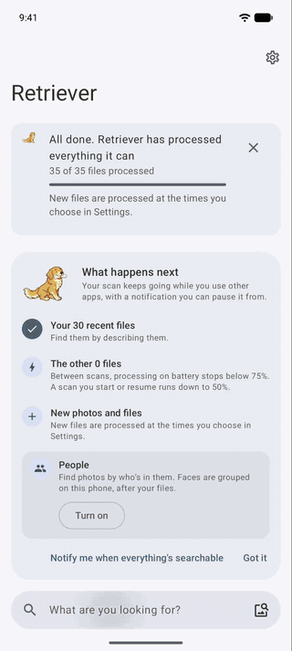

# Search your phone by describing it: EmbeddingGemma 2 on Android and iPhone

[Google Play](https://play.google.com/store/apps/details?id=app.retriever) ·
[App Store](https://apps.apple.com/app/id6829902478) ·
[20s demo video](https://youtu.be/C73lFjjDEcA) ·
[Source (Apache-2.0)](https://github.com/dhruv2295/Retriever) · free, no ads, no account

*Numbers below are from my own device runs and Firebase Test Lab; each table notes the workload and hardware.*

You remember the photo or PDF, not its name: *"whiteboard from Monday's meeting"*, *"electricity bill from March"*, *"the moment the cake comes out"*. Your gallery finds some of that; a WhatsApp file saved as `Document_04.pdf`, a screenshot of a Wi-Fi password, or page 12 of a 40-page lease, mostly not.

**Retriever** is a free, open-source Android and iPhone app that searches photos, screenshots, documents and videos by what's in them — on the device, with no account and no server. This post is about what it took to make that usable on a real library, because getting the model to run was the easy part.

## How it's built

- **One shared core, two native apps.** Indexing, hybrid search, SQLDelight storage, thermal rules and localization live in a Kotlin Multiplatform module (`core/`). Android uses Jetpack Compose plus a read-only `DocumentsProvider`, so you can search Retriever straight from Android's system file picker in other apps; iOS uses SwiftUI over a Kotlin/Native framework.
- **The model.** [EmbeddingGemma 2](https://huggingface.co/google/embeddinggemma-2) (440M text-vision LiteRT-LM export, [`litert-community/embeddinggemma-2-text-vision-440m-litert-lm`](https://huggingface.co/litert-community/embeddinggemma-2-text-vision-440m-litert-lm)), commit-pinned and SHA-256 verified on download. Supported NPUs get a chip-specific build (447–798 MB); other phones run the 388 MB generic build on whichever of GPU or CPU benchmarks faster on first run.
- **The index.** SQLite FTS4 covers filenames, document text and OCR; semantic search stores the first **256 Matryoshka dimensions quantized to `int8`** (256 bytes + float scale per photo, PDF page or video moment) scanned by a small Kotlin/C dot-product kernel. Every query runs both lanes and merges them, so *"invoice"* matches the exact word and *"flight tickets for the trip"* still finds `Document_04.pdf`.
- **Everything else on-device too.** OCR and photo labels via ML Kit (Android) / Apple Vision (iOS), plus opt-in People grouping (face detection and SFace) that stays off unless you turn it on.

## Snapdragon NPU support: what changed for users

Adding chip-specific NPU builds for **Snapdragon 8 Gen 2 – 8 Elite Gen 5** (`SM8550`–`SM8850`, alongside existing Pixel Tensor G5/G6 and MediaTek Dimensity 9400/9500 NPU builds) changed both typing a search and indexing a library.

*Firebase Test Lab (2026-11-25), warm median of 10 runs, embed-only at 70 vision tokens (the app's calibration reference budget). Query times measure model query-text encoding before FTS4 and the `int8` vector scan.*

| Device (SoC) | NPU embed | GPU embed | Speedup | Query embed (GPU → NPU) | Cold load (GPU → NPU) |
|---|---:|---:|---:|---:|---:|
| Galaxy S23 (`SM8550`) | **110 ms** | 215 ms | **1.95×** | 49 ms → **14 ms** | 7.2 s → **2.8 s** |
| Galaxy S24 Ultra (`SM8650`) | **91 ms** | 212 ms | **2.33×** | 43 ms → **8.8 ms** | 5.6 s → **2.2 s** |
| Galaxy S25 Ultra (`SM8750`) | **74 ms** | 155 ms | **2.09×** | 28 ms → **6.9 ms** | 4.9 s → **1.9 s** |
| Galaxy S26 (`SM8850`) | **61 ms** | 162 ms | **2.66×** | 36 ms → **6.4 ms** | 5.3 s → **1.8 s** |

What that means in practice:
- **Search feels instant:** Cold model open drops from 5–7 s to ~2 s, and query encoding drops **3.5–5.6×** down to **6–14 ms** — under a single 60 Hz frame.
- **Photo embedding speeds up ~2.0–2.7× at the reference budget:** Moving embedding from GPU to NPU cuts per-photo embed time from 155–215 ms to 61–110 ms (1.95–2.66×) and keeps inference off the GPU that draws the UI.
- **Zero bloat for other phones, zero downtime on upgrade:** Qualcomm's QNN runtime (`~8 MB`) lives in four Play device-targeted install-time modules (`npu/qualcomm_runtime_v*`), so Play delivers it only to matching Snapdragon chips. Existing Snapdragon users keep searching on their installed generic build until the chip-specific build finishes downloading, so an update never disables search.

| Build family (M440) | Model download | Runtime delivery |
|---|---:|---|
| Generic (GPU / CPU, Android & iOS) | 388 MB | Bundled in LiteRT-LM |
| Qualcomm Snapdragon (`SM8550`–`SM8850`) | 447–466 MB | Play device-targeted QNN module (~8 MB) |
| Google Tensor (`G5` / `G6`) | 513–559 MB | LiteRT-LM dispatch |
| MediaTek Dimensity (`9400` / `9500`) | 768–798 MB | LiteRT-LM dispatch |

## The real problem: the first run

A phone isn't a demo folder. My Pixel 11 Pro Fold has about 28,000 files and my Pixel 8 Pro has about 18,000 — mostly photos, plus thousands of screenshots and PDFs. Up to version 1.0.2, single-pass processing ran at about **85 photos a minute** on the Fold and took **7–8 hours on a charger** on the Pixel 8 Pro before search by description covered the library.

Here is where one photo's time went on both phones:

| Step | Pixel 11 Pro Fold (Tensor G6 NPU) | Pixel 8 Pro (Tensor G3 GPU) | Needed for search by description? |
|---|---:|---:|---|
| Open and decode | 28 ms | ~800 ms total *(decode + OCR + labels on CPU)* | Yes |
| Read text in image (OCR) | 236 ms | *(included above)* | No |
| Tag objects (labels) | 87 ms | *(included above)* | No |
| Embed image | ~180 ms (NPU) | ~480 ms (GPU) | Yes |
| **Single-pass sustained pace** | **~85 photos/min** | **~43 photos/min** *(~1.4 s/photo charging)* | — |
| **Pass 1 ("meaning first")** | **~350 photos/min** | *(skips OCR & labels on pass 1; GPU embed only)* | — |

### Meaning first (~4× sooner to useful search)

The image vector never used the OCR text or tags. Splitting photos into two passes — embed newest-first, then run OCR and labels right after — pushed pass 1 on the Fold from **~85 to ~350 photos a minute** (decoding the next photo overlaps with NPU embedding, bringing sustained wall time to ~170 ms/photo). On non-NPU phones like the Pixel 8 Pro, where CPU extraction alone took ~800 ms/photo, deferring OCR and labels cuts out the slowest step of the first pass too. Total time to "fully done" barely moves, but search by description is ready hours sooner.

### My own heat rule was the bottleneck

A trace of the new pipeline on the Fold showed half the photos sitting idle for 160–234 ms after finishing — almost exactly their own processing time. An earlier rule rested as long as each photo took whenever Android's thermal forecast crossed 0.85, which a charging phone hits continuously. Removing that half-speed rest (keeping only the existing pause at `SEVERE` heat or 0.95 headroom, and letting a screen-off charging phone run until the forecast itself reaches `SEVERE`) eliminated the self-inflicted stalls.

### What didn't work (and what's next)

- **Parallel ML Kit OCR:** Running multiple ML Kit Latin text recognizers at once didn't speed up OCR. Reading ML Kit's bytecode showed every Latin recognizer feeds a single process-wide queue. Overlapping OCR with the next photo's embedding worked instead.
- **Zero-shot tags from the vector:** Scoring the image vector against a label list beat ML Kit on concrete COCO objects, but in blind judging across real photos ML Kit won overall (**84% vs 71%** over 252 tags each). I kept ML Kit for tags.
- **Vector face pre-filter (next up):** Optional People face scanning took ~0.3 s/photo on the Pixel 8 Pro (~1.5 hours for 16,700 photos). In a 450-photo offline test on that phone, asking the existing image vector whether a face was present would have skipped face detection on **~47% of photos** while catching **35 of 36** with faces — not wired into the app yet, but next on my list.

## Outside the NPU: Pixel 8 Pro and iPhone 12 mini

Most phones don't have a supported NPU, and that's where GPU-vs-CPU behavior directly shapes the app experience:

- **Pixel 8 Pro (Tensor G3, generic build).** GPU indexing was more than twice as fast as CPU (**0.87 s vs 1.97 s/photo** in benchmarks; **~1.4 s vs ~2.1 s** during steady charging), but caused **3× as many janky UI frames** while the app was visible. Retriever now detects rendering stalls during first-run tuning, switches to CPU while you're interacting with the app, and moves back to GPU after 30 seconds untouched on a charger.
- **iPhone 12 mini (A14, 4 GB RAM).** At full speed on a charger, the phone hit Apple's `serious` thermal state after **90 seconds** — which is why `serious` now slows reading instead of pausing, and only `critical` pauses. And because the 12 mini doesn't advertise background GPU support in `BGTaskScheduler.supportedResources`, leaving the app drops background reading to CPU — roughly **10× slower** than while Retriever is open.

## Keeping the Play download small

Shipping on-device ML usually bloats installs. Moving ML Kit's Latin/Devanagari OCR, image labeler, and face detector to Google Play services — and moving SFace (`facepack/`) into an on-demand Play asset pack fetched only when People is enabled — cut the arm64 Play download from **56.6 MB to 19.1 MB** (`bundletool get-size`, measured before 1.0.3–1.0.5), plus ~8 MB for Qualcomm's QNN runtime delivered only to matching Snapdragon SoCs.

## Making the wait legible

Fast isn't enough when a library has 20,000+ files. On first run, Retriever uses the setup demo's measured pace to set an honest range (*"under an hour"*, *"a few hours"*, *"about a night"*), then breaks processing into up to four steps (three unless People is turned on), each explaining what becomes searchable when it finishes:

1. **Learning what's in your files** → find any photo or file by describing it
2. **Reading the words in your photos** → search receipts, signs, notes
3. **Finding people in your photos** *(optional)* → find photos of someone by name
4. **The rest of long files** → search deep inside long PDFs and videos

While a step runs, a golden retriever acts it out on the home screen — sniffing folders, tilting its head at a photo, nose to a receipt — so you can tell the app is working without staring at a counter.

## Privacy, concretely

Files, queries and the search index stay on your phone — there is no Retriever account or backend, and the App Store label is **"Data Not Collected"**. After the one-time SHA-256-verified model download, search works offline. On Android, Google Play services downloads ML Kit's text-recognition and image-label models (and the face detector if People is turned on), may download additional OCR models for scripts like Chinese or Japanese, and may send Google its own diagnostics (device model, OS and app version, a per-installation identifier, timings and error codes — never your files or text). Full details live in [PRIVACY.md](../PRIVACY.md).

## Try it, read it, break it

- **Download:** [Google Play](https://play.google.com/store/apps/details?id=app.retriever) · [App Store](https://apps.apple.com/app/id6829902478) (free, no ads)
- **Code:** [github.com/dhruv2295/Retriever](https://github.com/dhruv2295/Retriever) (Apache-2.0) — the processing rules, hybrid search, thermal policy and mascot director all live in `core/`.

If you build on-device AI on phones — especially with LiteRT-LM, NPU delegates, or multi-hour background indexing — I'd love to compare notes.
